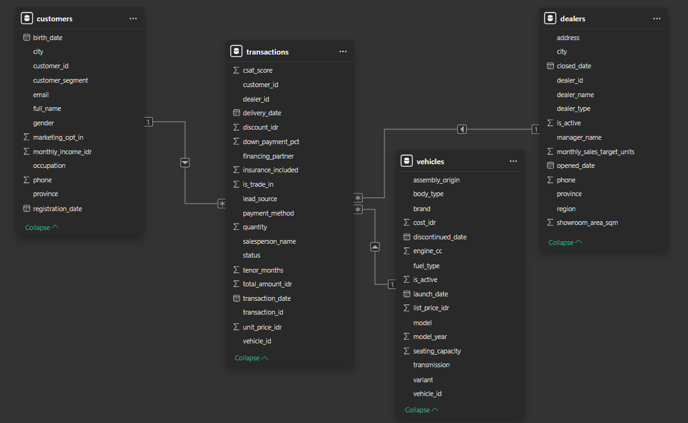
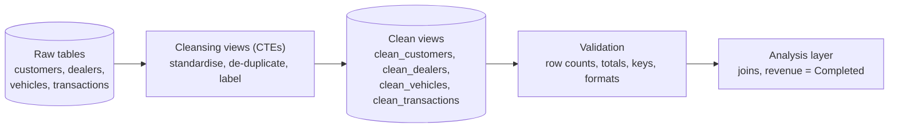

# Nusantara Car Motor: Sales, Marketing Analysis (2021–2026)


An end-to-end business intelligence and data analytics portfolio project evaluating **5.75 years of commercial performance** for Nusantara Car Motor (January 2021 – September 2026). This project investigates structural revenue deceleration, customer segment behaviors, inventory efficiency, and revenue leakage across 32 dealerships in Indonesia.

---

## 📊 Executive Summary & Business Context

Nusantara Car Motor operates a multi-brand automotive network spanning 13 brands, 62 vehicle variants, and 6 regional markets across Indonesia. Across **11,939 transactions**, the business accumulated **Rp 5.61 Trillion in gross revenue**. However, exploratory analysis uncovered two critical strategic vulnerabilities:
1. **Uninterrupted Growth Deceleration:** Following a post-pandemic peak in 2022 (+64.98% YoY), yearly revenue growth slowed continuously down to +33.6% in 2023, +22.41% in 2024, and +4.41% in 2025.
2. **Persistent Revenue Leakage:** Approximately **9.1% of booked revenue** is lost annually due to customer order cancellations and vehicle returns, accompanied by margin erosion from unmonitored discounting.

---

## 🏗️ Project Architecture & Data Pipeline

The analysis follows an industry-standard data stack, moving from raw data extraction to data cleansing in cloud warehousing and final visualization in Business Intelligence tools.

---

## Data Model
The underlying data model utilizes a star schema model to structure and integrate all datasets across the project.



## Data Exploration & Data Cleaning Phase

Before any analysis, every table was inspected and then cleaned in BigQuery, so each number in the analysis can be traced back to a documented decision. Raw tables are never modified; all cleaning lives in four SQL views.

### 🔍 Data Exploration

**Goal:** understand what each table contains and find anything that could distort the analysis, before changing a single value.

| Table | Rows | Contents |
|---|---|---|
| customers | 10,690 | 9,742 Retail, 724 Corporate, 224 Fleet |
| dealers | 32 | 10 Main Dealers, 17 Authorized Dealers, 5 Satellite Showrooms |
| vehicles | 62 | 13 brands, 56 models |
| transactions | 11,939 | 1 Jan 2021 to 27 Sep 2026 (Completed 10,655, Cancelled 760, Returned 315, Pending 209) |

**Five checks were run on the data**

1. **Duplicates:** Retail customers grouped by cleaned name and standardised phone number.
2. **NULL values:** one COUNTIF(column IS NULL) per column, applied to all four tables.
3. **Non-standard values:** each raw value compared with TRIM(INITCAP(value)).
4. **Outliers:** interquartile range (IQR) on total_amount_idr.
5. **Validation:** date order, amount formula and business-logic rules.

**What the exploration found**

| Area | Finding | Decision |
|---|---|---|
| Duplicate customers | 84 Retail customers registered twice (same name, phone and birth date) | Soft merge with master_customer_id: 10,606 unique customers |
| Phone numbers | Loaded as INT64, so the leading 0 was lost (10,388 start with 8, 24 with 62, 278 NULL) | Standardise to country-code format (62...) |
| City names | 149 spellings for 36 cities (330 rows) | INITCAP(TRIM()) |
| NULLs that carry meaning | 948 gender and birth dates (Corporate and Fleet), 3,868 financing fields (Cash deals), 969 delivery dates (Cancelled and Pending) | Kept as NULL, because there is nothing to fill |
| NULLs that are missing data | Email 423, salesperson 164, lead source 331 | Email stays NULL; the other two become "Unknown" |
| Survey score | csat_score is NULL in 5,890 rows (969 not applicable, 4,921 no response) | Kept as NULL; csat_category added |
| Outliers | 1,363 upper outliers in total_amount_idr (11.4%), including 97.5% of Fleet deals | Valid bulk purchases of up to 15 units, kept |
| Unit price vs list price | Above list price in 85.8% of rows (annual price increase, at most 1.076x); 4 sales below vehicle cost | Not errors; kept and flagged for the analysis |

**Validation results (zero violations)**

- ✅ Delivery never comes before the transaction (3 to 60 days after, median 31).
- ✅ No sale before a vehicle's launch or after its discontinuation, before a dealer opened or after it closed, or before the customer registered.
- ✅ total_amount_idr = quantity x (unit_price_idr - discount_idr) holds for all 11,939 rows, so the discount is per unit.
- ✅ No orphan keys between transactions and customers, vehicles or dealers.

### 🧹 Data Cleaning

**Principles:** raw tables are never modified, no row is deleted (rows in = rows out), structural NULLs are not filled with 0, and every decision is documented.



| View | Source | Rows in → out |
|---|---|---|
| clean_customers | customers | 10,690 → 10,690 (10,606 unique customers) |
| clean_dealers | dealers | 32 → 32 |
| clean_vehicles | vehicles | 62 → 62 |
| clean_transactions | transactions | 11,939 → 11,939 (one added column, csat_category) |

**Cleaning rules**

- **Text:** names use INITCAP(TRIM()) for Retail and TRIM() only for companies, so "PT" and "CV" are not damaged. Email uses LOWER(TRIM()) and city uses INITCAP(TRIM()).
- **Phone:** numbers starting with 8 get the prefix 62, and all 32 dealer numbers get 62. Every non-NULL customer number now matches ^628[0-9]{9,10}$.
- **Flags:** 1/0 become Yes/No (trade-in, insurance, marketing opt-in) and Active/Inactive (dealers, vehicles).
- **NULL labels:** COALESCE turns missing salesperson and lead source into "Unknown" and Cash deals financing partner into "Not Used". Down payment and tenor stay NULL, because 0 would distort averages.
- **Survey score:** csat_score stays NULL (never 0). csat_category groups it into satisfied, neutral, dissatisfied, N/A (never delivered) and No Response.

**Key decision: soft merge instead of delete.** Duplicate customers keep every raw row and their original customer_id, and receive a master_customer_id:

```sql
CASE WHEN customer_segment = Retail AND phone IS NOT NULL THEN
  FIRST_VALUE(customer_id) OVER (
    PARTITION BY full_name, phone
    ORDER BY (email IS NOT NULL) DESC, registration_date, customer_id)
ELSE customer_id END AS master_customer_id
```

- A phone number identifies a person far better than a name, so the key is cleaned name plus cleaned phone.
- The master record is the one with an email, then the earliest registration, then the lowest ID.
- phone IS NOT NULL stops unrelated customers from being merged just because they share a name and have no phone.
- Corporate and Fleet are never merged: 176 of the 184 repeated company names have different phones.
- Result: 84 duplicate groups and 10,606 unique customers. 56 transactions reference a non-master ID, so customer-level metrics always group by master_customer_id.
- Deleting or re-pointing IDs would break the link to transactions and hide that a customer re-registered.

**Revenue definition.** Revenue counts only Completed transactions: Rp 5.61 trillion of the Rp 6.30 trillion booked. Pending deals are booked sales, not revenue, and Cancelled and Returned are excluded. Margin analysis joins clean_vehicles on vehicle_id to obtain cost_idr.

**Validation results (all passed)**

- ✅ Row counts match the raw tables (10,690 / 32 / 62 / 11,939).
- ✅ Total total_amount_idr is identical before and after cleaning (Rp 6,299,981,200,000), and Completed revenue is unchanged (Rp 5,611,376,200,000).
- ✅ 84 duplicate groups and 10,606 unique customers; no Corporate or Fleet record merged.
- ✅ Phone formats valid, NULL fills match expectations (164 / 331 / 3,868), no orphan keys.
- ✅ Joining transactions to customers keeps exactly 11,939 rows (no fan-out).

---

📄 **Here is the documentation for data exploration:** [Data Inspection & Exploration Document (Explanation).pdf](https://github.com/yoskev/Data-Analysis-Project-Sales-Marketing-Automotive-Car-Analysis/blob/main/Data%20Exploration%20Phase/Data%20Inspection%20%26%20Exploration%20Document(Explanation).pdf)

📄 **Here is the documentation for data cleaning:** [Data Cleaning, Formatting and Validation Approach Document.pdf](https://github.com/yoskev/Data-Analysis-Project-Sales-Marketing-Automotive-Car-Analysis/blob/main/Data%20Cleaning%20Phase/Data%20Cleaning%2C%20Formatting%20and%20Validation%20Approach%20Document.pdf)

## 🔍 Key Findings & Business Insights

1. **Yearly Revenue and Growth:** Cumulative completed revenue from 2021 through September 2026 reached Rp 5.61 trillion. Following a post-pandemic market rebound in 2022 (+64.98% YoY), yearly revenue growth decelerated significantly, dropping to +33.6% in 2023, continue to +22.41% in 2024, and slowing down to +4.41% in 2025.
**Recommendation :**
    Because YoY growth has slowed down without interruption since 2022, management must treat this as a structural maturity phase rather than a temporary market dip. Company need Treat the slowdown as the main business issue and set 2026      and 2027 growth targets per segment instead of one company-wide figure. Track revenue growth together with transaction count every quarter, so a price-driven increase is not mistaken for volume growth.
   
2. **Revenue Leakage:** 
3. **Retail vs. Fleet Dynamics:** While Retail drives high nominal transaction counts, the B2B **Fleet segment** demonstrates an exceptional **84.7% repeat purchase rate**, generating nearly 33% of company revenue with low acquisition overhead.
4. **Discount Elasticity & Margin Erosion:** Transactions with high discount percentages (>7%) experience critical net profit margin compression, with several deals falling below operational cost thresholds.
5. **Geographical City Demand:** Unserved regional cities (such as Cirebon, Samarinda, Serang, and Jambi) account for over **Rp 326 Billion** in organic demand captured remotely through existing dealer channels, justifying physical satellite expansion.

---

## 💡 Strategic Recommendations & Action Plan

* **1. Rebalance customer Acquisition to Fleet B2B Accounts, instead just focus on Retail:**  Sales management team must maintain and expand high value B2B Fleet and Corporate relationship by assign dedicated account management team then introduce plenty program like loyalty program, special event promotion to engage sales transaction from these segments.
  
* **2. Implement a Risk Discount Management Plan:** Create risk discount management plan to mitigate decreasing of net profit margin. Company can implement discount management system, whom need approval by sales marketing Top Management. Then keep monitor discount and margin per segment every month.

  With discounts climb higher, net margins collapse—with several transactions dipping below cost. Without strict controls, frontline sales reps give away too much margin just to close individual deals and hit short-term unit targets.

* **3. Reallocate Inventory for High Demand Brand – Model Vehicles to High Demand Regions and City:**  Sales Marketing teams should sell high demand vehicles that usually eager to buy from customers. Also build new dealers at city that untapped like 8 high-demand cities for physical market expansion. These list of cities: Cirebon, Samarinda, Serang and Jambi; Sukabumi, Kendari, Kupang and Mataram could be real potential to gain revenue growth.

  Also, Management must reallocate stock to high-efficiency and top car specification mixes, penalize chronically underperforming dealers after fixing proper monthly target units, and establish new dealers in proven unserved city markets.


---

## 🚀 Summary of Key Insights & Strategic Impact

> **The Bottom Line:** Nusantara Car Motor's historic growth model of relying on broad retail walk-ins is facing diminishing returns. By addressing the **9.1% revenue leakage**, instituting **strict discount governance**, pivoting resources toward high-value **B2B Fleet accounts**, and expanding into verified **regional white-spaces**, management can recover lost margin and stabilize long-term profitability across the 32-dealer network.

---

## 👤 Author

**Yosafat Kevin Sirumapea**
* **Role:** Data Analyst & Systems Professional (Information Systems - Business Intelligence)
* **Connect:** [LinkedIn Profile](https://www.linkedin.com/in/yosafat/) | [GitHub Portfolio](https://github.com/yoskev)
